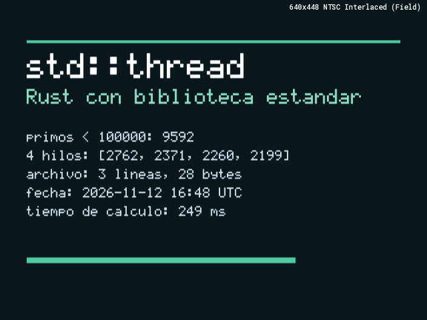
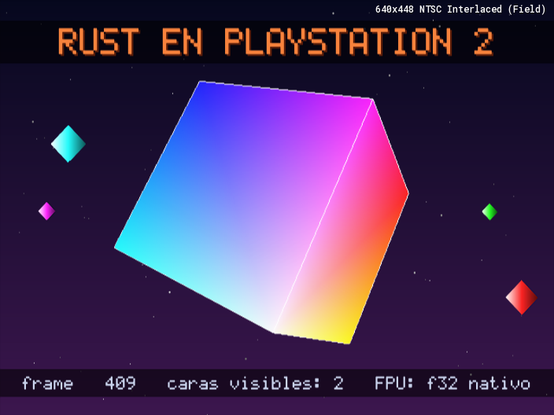
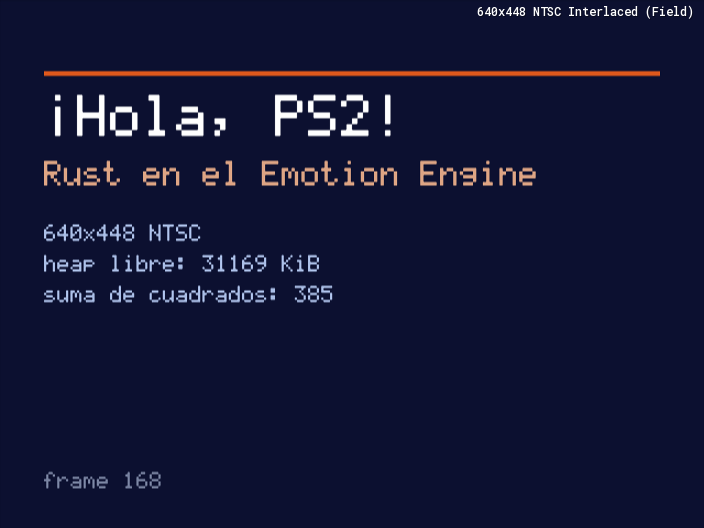
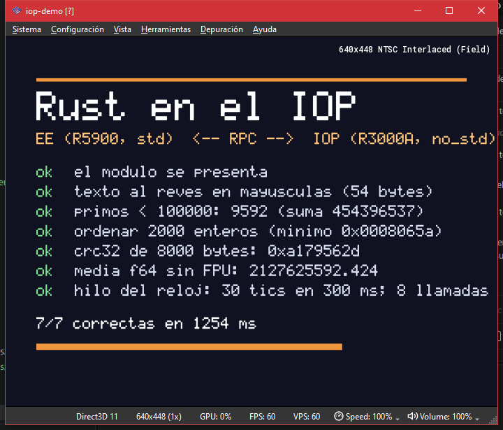

# PS2Rust — Rust para PlayStation 2

Compila programas en Rust, **con la biblioteca estándar**, a ejecutables ELF
para el Emotion Engine (MIPS R5900) de la PlayStation 2. No usa C ni PS2SDK:
el arranque, el kernel, la comunicación con el procesador de E/S, los hilos,
los archivos y los gráficos están escritos en Rust.

También compila **módulos IRX para el IOP** (el procesador de E/S, un MIPS
R3000A con 2 MiB de RAM), sin std: ver [Rust en el IOP](#rust-en-el-iop).

| [`std-hello`](examples/std-hello/src/main.rs) | [`cube`](examples/cube/src/main.rs) | [`hello`](examples/hello/src/main.rs) |
|---|---|---|
|  |  |  |

```rust
use std::{fs, thread, collections::HashMap, time::Duration};

fn main() {
    let worker = thread::spawn(|| (1..=10u32).map(|n| n * n).sum::<u32>());
    let mut save = HashMap::new();
    save.insert("nivel", worker.join().unwrap());
    fs::write("partida.txt", format!("{save:?}")).unwrap();
    thread::sleep(Duration::from_millis(100));
    println!("{}", fs::read_to_string("partida.txt").unwrap());
}
```

```
cargo ps2 run -p std-hello
```

## La biblioteca estándar en la PS2

| Módulo | En la PS2 |
|---|---|
| `std::thread` | Hilos del kernel del EE: `spawn`, `join`, `scope`, `Builder`, `park`/`unpark`, `sleep`, `yield_now`, `thread_local!` (con destructores) |
| `std::sync` | `Mutex`, `Condvar`, `RwLock`, `Once`, `OnceLock`, `LazyLock`, `Barrier`, `mpsc`, atómicos; todo sobre un futex propio |
| `std::time` | `Instant` con el contador de ciclos (resolución de 3,4 ns); `SystemTime` con el reloj de tiempo real de la consola |
| `std::fs` | `host:` (el PC, con PCSX2 o ps2link), `mc0:`/`mc1:` (tarjetas de memoria; los módulos se cargan solos), `cdrom0:` (el disco). Leer, escribir, `seek`, `append`, `metadata`, `read_dir`, `create_dir_all`, `remove_*`, `copy`, `rename` |
| `std::io` | `stdout`/`stderr` a la consola del EE; `stdin` siempre vacío |
| `std::env` | `args` (el kernel los pasa), variables en memoria, `current_dir`/`set_current_dir` (al empezar, el directorio del ELF) |
| `std::collections` | Todo, incluidos `HashMap`/`HashSet` con semillas aleatorias |
| `std::process` | `exit` y `abort`; no hay `Command` |
| `std::net` | No disponible (no hay pila de red) |
| `std::os::ps2` | `load_iop_module`, `SifRpcClient` (llamadas RPC a módulos del IOP: mandos, sonido…), `reset_iop` (reinicia el IOP con los módulos de la BIOS), `cpu_cycles`, `heap_free_bytes` |

Un pánico (en cualquier hilo) imprime el mensaje y termina con código 101: se
compila con `panic = "abort"`, no hay desenrollado.

Los hilos son **cooperativos**: todos tienen la misma prioridad en el kernel,
así que un hilo corre hasta que se bloquea (E/S, `Mutex`, canal, `join`),
duerme o llama a `thread::yield_now`. Es el modelo habitual de los juegos de
PS2, y además hace correctos los atómicos del R5900 (ver más abajo).

## Cómo funciona

No es un fork de `rustc`. Es el `rustc` que ya tienes instalado, dirigido a un
target nuevo, más pasos propios antes y después de compilar:

1. **Target `mipsel-sony-ps2`** ([spec](toolchain/cargo-ps2/assets/mipsel-sony-ps2.json)),
   con `target_os = "ps2"`: MIPS II little-endian, ABI o32, FPU de precisión
   simple (`f64` por software), sin PIC, y con el relleno de delay slots de
   LLVM desactivado para esquivar la errata de bucles cortos del R5900.
2. **La std con una plataforma nueva.** `cargo ps2` copia el código de la std
   de tu toolchain (`rust-src`) a `target/ps2-toolchain/`, añade la rama
   `target_os = "ps2"` en cada selector de plataforma (24 inserciones,
   [stdsrc.rs](toolchain/cargo-ps2/src/stdsrc.rs), cada una comprobada contra
   el original) y le suma la implementación de
   [toolchain/std-ps2](toolchain/std-ps2). Luego compila `std`, `core`,
   `alloc` y `panic_abort` con `-Zbuild-std`.
3. **El sistema operativo, en Rust** ([std-ps2/os](toolchain/std-ps2/os)):
   syscalls del kernel del EE; el protocolo SIF (comandos y RPC por DMA)
   para hablar con el IOP; los servidores de la BIOS FILEIO (archivos),
   LOADFILE (módulos) y CDVD (reloj); un temporizador de 1 kHz sobre el
   Timer 1 que extiende el contador de ciclos a 64 bits y despierta a los
   hilos dormidos; un futex; y el heap.
4. **Enlazado** con `rust-lld` y un [linker script](toolchain/cargo-ps2/assets/ps2.ld)
   que carga el programa en `0x00100000`.
5. **Legalización para el R5900** ([r5900.rs](toolchain/cargo-ps2/src/r5900.rs)).
   LLVM no conoce el R5900, así que el ELF enlazado se parchea in situ:

   | LLVM emite | El R5900 | Se reescribe como |
   |---|---|---|
   | `ll` / `sc` + `beqz` (atómicos) | no los tiene | `lw` / `sw` + `li 1` |
   | `c.ult.s`, `c.ule.s`, `c.un.s`… | sólo C.F, C.EQ, C.LT, C.LE | la variante ordenada (su FPU no tiene NaN) |
   | `trunc.w.s` | no existe | `cvt.w.s` (en el R5900 siempre trunca) |
   | `sqrt.s fd, fs` | el operando va en `ft` | mismo opcode, campo movido |
   | `lwl` + `lwr` cuyo valor se usa en cálculos | ver abajo | desvío a un trampolín que añade `sll rt, rt, 0` |

6. **Verificación**: se decodifica cada instrucción del ELF final. Lo que el
   R5900 no implementa (`dmult`, `ddiv`, `movf`, dobles en FPU, `ldc1`…), un
   bucle corto con el delay slot ocupado o una carga no alineada sin corregir
   hacen fallar la compilación.

Todo eso lo orquesta `cargo ps2`, un binario sin dependencias en
[toolchain/cargo-ps2](toolchain/cargo-ps2).

### Las cargas no alineadas y el recompilador de PCSX2

El R5900 tiene registros de 64 bits: el código de 32 bits funciona porque cada
instrucción deja el resultado con el signo extendido a los 64 bits. Con la std
apareció un cuelgue intermitente dentro de `HashMap`: el recompilador del EE de
PCSX2 no extiende el signo en las cargas no alineadas `lwl` + `lwr` (deja ceros
arriba), y las comparaciones de 64 bits del bucle de búsqueda nunca terminaban.
El intérprete de PCSX2 sí lo hace bien.

La corrección está en [unaligned.rs](toolchain/cargo-ps2/src/unaligned.rs):
un análisis de flujo comprueba, por todos los caminos, si el valor cargado sólo
se escribe a memoria (las copias, que son la mayoría); si no, la pareja se
desvía a un trampolín que la ejecuta en su orden y añade `sll rt, rt, 0`. Si
entre las dos mitades hay otras instrucciones, se reagrupan cuando se puede
demostrar que es seguro (no tocan el registro ni la base, y ninguna es destino
de un salto, contando las tablas de saltos de los datos).

## Rust en el IOP

La PS2 tiene un segundo procesador, el IOP: un R3000A (MIPS I, el de la
PlayStation original) con 2 MiB de RAM que se ocupa de los mandos, el sonido,
el disco y la red. Sus programas son módulos `.irx` que la BIOS carga y enlaza
con el kernel. `cargo ps2 build --iop` los compila desde Rust (`no_std` +
`alloc`), con el crate [`ps2-iop`](crates/ps2-iop/src/lib.rs) como runtime:

```rust
#![no_std]
#![no_main]
use ps2_iop::{println, rpc};

ps2_iop::module!(name: "doble", version: (1, 0), main: main);

fn main() {
    println!("hola desde Rust en el IOP");
    // Servidor RPC: un programa del EE lo llama con SifRpcClient.
    rpc::serve(0x1234_5678, 64, |_function, data, _received| {
        let n = u32::from_le_bytes(data[..4].try_into().unwrap());
        data[..4].copy_from_slice(&(n * 2).to_le_bytes());
    });
}
```



En la captura, [`iop-demo`](examples/iop-demo/src/main.rs) (EE, con std) carga
[`rustiop.irx`](examples/iop-module/src/main.rs) en el IOP y le pide por RPC
dar la vuelta a un texto UTF-8, cribar primos, ordenar, un CRC-32 y una media
en `f64`; cada respuesta se compara con el mismo cálculo hecho en el EE.
Mientras, un segundo hilo del módulo cuenta tics.

| Módulo de `ps2-iop` | Qué ofrece |
|---|---|
| `module!` | Identidad del módulo, punto de entrada y `main` en su propio hilo |
| `print!` / `println!` | Consola del IOP |
| `heap` | Asignador global (`Box`, `Vec`, `String`, `BTreeMap`…) sobre un bloque pedido al kernel |
| `thread` | Hilos del kernel, expulsivos y con prioridades: `spawn`, `Builder`, `sleep_ms` |
| `sync` | `Mutex` y `Semaphore` (semáforos del kernel) |
| `rpc` | `serve`: servidor RPC para los programas del EE |
| `time`, `math` | Reloj del sistema; `sqrt` en `f32` sin FPU |
| `kernel` | Las funciones importadas de la BIOS (`thbase`, `thsemap`, `sysmem`, `intrman`, `sifcmd`, `stdio`) y `critical` |

Cómo se llega del código de Rust a un `.irx`:

1. **Target `mipsel-sony-ps2iop`**: MIPS I, coma flotante por software, sin
   atómicos (el R3000A no tiene `ll`/`sc`), sólo `core` y `alloc`.
2. **Importaciones.** En el IOP no hay syscalls: cada función del kernel se
   declara en una tabla dentro del código, con un hueco de dos instrucciones
   que el cargador sustituye por un salto. Las genera una macro de `ps2-iop`.
3. **Conversión a IRX.** El módulo se enlaza en la dirección 0 conservando las
   relocaciones y `cargo-ps2` lo convierte al formato de Sony (ELF de tipo
   `0xFF80`, sección `.iopmod`, relocaciones relativas a la base de carga).
4. **El cargador de la BIOS ignora un `R_MIPS_LO16` que no vaya justo detrás
   de un `R_MIPS_HI16`.** Los compiladores de C emiten siempre la pareja, pero
   LLVM reutiliza un `lui` para varios accesos; sin corregirlo, el módulo carga
   y luego lee y escribe en direcciones equivocadas. El conversor empareja cada
   entrada con palabras auxiliares (detalles en
   [irx.rs](toolchain/cargo-ps2/src/irx.rs)).
5. **HI/LO.** MIPS I pide dos instrucciones entre `mfhi`/`mflo` y el siguiente
   `mult`/`div`; LLVM no las pone. `cargo-ps2` desvía esas secuencias a
   trampolines que guardan la distancia.
6. **Verificación.** Todo IRX se revisa instrucción a instrucción: sólo MIPS I,
   sin FPU, respetando el retardo de carga y la regla de HI/LO. Con
   `--verify-relocs` además se enlaza el módulo en otra dirección y se comprueba
   que el IRX, reubicado ahí con las reglas del cargador, queda idéntico
   palabra por palabra.

## Requisitos

- Rust estable con el componente `rust-src` (`rustup component add rust-src`).
  Probado con rustc 1.97.1. `cargo ps2` activa `RUSTC_BOOTSTRAP=1` porque el
  target JSON, `build-std` y el ensamblador en línea para MIPS son inestables.
  Si una versión futura de Rust cambia los archivos de la std que se parchean,
  `cargo ps2` lo detecta y lo dice en vez de compilar algo roto.
- Para `cargo ps2 run`: PCSX2 con una BIOS (la BIOS no se incluye: vuélcala de
  tu consola). La ruta del emulador se toma de `--emulator` o de la variable de
  entorno `PCSX2_EXE`; también se puede fijar en [.cargo/config.toml](.cargo/config.toml).
  Para que `host:` funcione, PCSX2 necesita la opción *Host Filesystem*
  activada.

## Uso

Desde la raíz de este repositorio no hay que instalar nada (hay un alias en
`.cargo/config.toml`):

```
cargo ps2 run -p std-hello         # compila y ejecuta en PCSX2, mostrando la consola
cargo ps2 build -p cube            # compila -> target/ps2/cube.elf
cargo ps2 run -p cube --until "240 frames" --screenshot cube.png
cargo ps2 check juego.elf          # ¿este ELF sólo usa instrucciones del R5900?
cargo ps2 build --iop -p rustiop   # módulo del IOP -> target/ps2/rustiop.irx
cargo ps2 run -p iop-demo          # el programa del EE que lo carga y lo llama
cargo ps2 check modulo.irx         # ¿este IRX sólo usa instrucciones del R3000A?
cargo ps2 help
```

Compila los paquetes de uno en uno (`-p`): los ejemplos sin std y con std usan
el crate `ps2` con features distintas, y los módulos del IOP son otro target.
Un programa del EE carga un módulo con `std::os::ps2::load_iop_module`; en
PCSX2, `host:` es el directorio del ELF (`target/ps2`), donde también quedan
los `.irx`.

Para usarlo en un proyecto propio, fuera de este repositorio:

```
cargo install --git https://github.com/mostazaniikkkk/PS2Rust cargo-ps2
```

```toml
# Cargo.toml de tu proyecto
[dependencies]
# Gráficos y hardware; sin el runtime no_std, porque lo pone la std.
ps2 = { git = "https://github.com/mostazaniikkkk/PS2Rust", default-features = false }

[profile.release]
panic = "abort"
```

Para un módulo del IOP, la dependencia es
`ps2-iop = { git = "https://github.com/mostazaniikkkk/PS2Rust" }`.

El `.elf` resultante se puede cargar en PCSX2 (Sistema → Ejecutar ELF) o en una
consola con un lanzador de homebrew.

## El crate `ps2`

El hardware que la std no cubre. Con la std se usa con
`default-features = false`; sin std (`#![no_std]`), la feature `rt` (por
defecto) añade el arranque, el asignador, el manejador de pánicos y
`ps2::entry!`.

| Módulo | Qué ofrece |
|---|---|
| `gs` | Graphics Synthesizer: NTSC/PAL, doble búfer, vsync, rectángulos, líneas, triángulos Gouraud, mezcla alfa, texto |
| `math` | `sqrt`, `sin`, `cos`, `floor` en `f32` sobre la FPU |
| `kernel` | Syscalls del kernel del EE y registros de hardware de 32 y 64 bits |
| `print!` / `println!` | Consola del EE, también sin std |
| `entry!`, `heap`, `exit` | Sólo con `rt`: el runtime de los programas `no_std` |

## Ejemplos

- [std-hello](examples/std-hello/src/main.rs): cuatro hilos y un canal, `HashMap`, un archivo, el reloj de la consola y el resultado en pantalla.
- [std-selftest](examples/std-selftest/src/std_suite.rs): batería de la std (25 comprobaciones, más las 33 de `core`/`alloc`).
- [std-panic](examples/std-panic/src/main.rs): pánico en un hilo con nombre.
- [hello](examples/hello/src/main.rs), [cube](examples/cube/src/main.rs), [selftest](examples/selftest/src/suite.rs), [panic](examples/panic/src/main.rs): los mismos temas sin std (`#![no_std]`).
- [iop-module](examples/iop-module/src/main.rs) (`rustiop.irx`) e [iop-demo](examples/iop-demo/src/main.rs): un módulo del IOP con servidor RPC y dos hilos, y el programa del EE que lo usa.
- [iop-selftest](examples/iop-selftest/src/main.rs) e [iop-selftest-runner](examples/iop-selftest-runner/src/main.rs): la batería de `core`/`alloc` corriendo en el IOP, lanzada desde el EE.

## Verificación

```
powershell -ExecutionPolicy Bypass -File verify.ps1 -Emulator C:\ruta\pcsx2-qt.exe
```

El script compila los nueve programas del EE y los dos módulos del IOP, los
ejecuta en PCSX2 y comprueba los resultados (13 pasos). Las pruebas principales
son diferenciales: las baterías se compilan tal cual para el PC y para la PS2,
y las dos salidas deben coincidir byte a byte (212 líneas con la std en el EE;
131 en el IOP, donde la misma batería corre sin FPU ni atómicos). Cubren enteros de 32/64/128
bits, `f64` por software, `f32` en la FPU, formato, colecciones, `Rc`/`Arc`,
atómicos, el heap, UTF-8, hilos, `Mutex`/`Condvar`/`RwLock`/`Barrier`,
canales, `thread_local!`, `sleep`, `SystemTime`, archivos (incluidos nombres
de 1 a 16 caracteres) y el entorno.

## Límites conocidos

- **Probado sólo en emuladores** (PCSX2 2.7.513 con BIOS real, y Play! 0.47 la
  versión sin std), no en una consola física.
- **Hilos cooperativos.** No hay reparto de tiempo: un hilo que calcula sin
  bloquearse ni ceder no deja correr a los demás. Los atómicos se compilan como
  `lw`/`sw` (el R5900 no tiene `ll`/`sc`); son correctos porque ningún hilo
  pierde la CPU en medio de una operación y los manejadores de interrupción no
  los usan.
- **ABI o32 de 32 bits.** No se puede enlazar con las bibliotecas C de PS2SDK
  (que usan n32). `u64` funciona pero con pares de registros; no hay acceso a
  los registros de 128 bits (MMI) ni a las unidades vectoriales.
- **`f32` sigue la FPU de la PS2**, no IEEE 754: sin NaN, infinitos ni
  denormales, y redondeo hacia cero. `f64` sí es IEEE 754 (por software, lento).
- **Archivos**: el FILEIO de la BIOS no sabe renombrar (`rename` copia y borra,
  no es atómico), ni bloquear, truncar o cambiar fechas y permisos. Un archivo
  abierto no se puede borrar en `host:`. Las fechas de la PS2 están en hora de
  Japón; las de los archivos de `host:` con PCSX2 llegan en la hora local del
  PC, así que `modified()` puede desfasarse unas horas.
- **Sin `std::net`, `std::process::Command` ni `stdin`.** El mando y el sonido
  tampoco están: viven en el IOP y necesitan sus propios módulos.
- **IOP: sin std, sin atómicos y sin FPU.** Sólo `core` y `alloc`; no hay
  `Arc` ni `core::sync::atomic` (para compartir datos entre hilos están
  `ps2_iop::sync::Mutex` y `kernel::critical`), y `f32`/`f64` van por software.
  Un pánico imprime el mensaje y deja dormido el hilo: el módulo no se descarga.
  `ps2-iop` cubre hilos, semáforos, memoria, consola y RPC; para otros servicios
  del kernel (interrupciones, DMA, dispositivos) hay que declarar sus tablas de
  importación con la misma macro. El comportamiento del cargador se ha medido
  con la BIOS real dentro de PCSX2, no en una consola.
- PCSX2 decodifica la consola del EE como Shift-JIS: el texto no ASCII, `\` y
  `~` se pierden en su log (no en pantalla; `gs::text` dibuja `ñ`, `¡` y `¿`).

## Licencia

[CC0 1.0](LICENSE): dominio público. Haz lo que quieras con esto, sin pedir
permiso ni dar crédito. La std que `cargo ps2` genera en `target/` es una copia
modificada de la de Rust y conserva su licencia (MIT o Apache 2.0).
