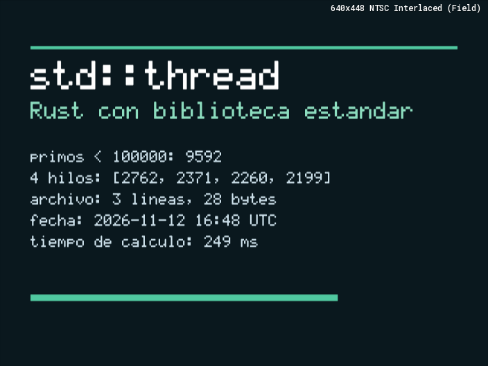
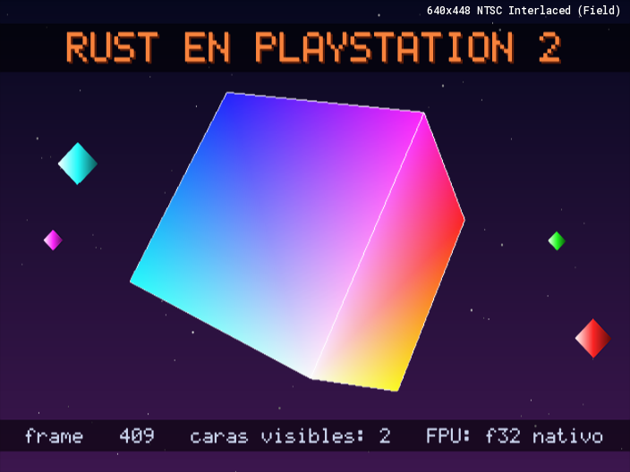
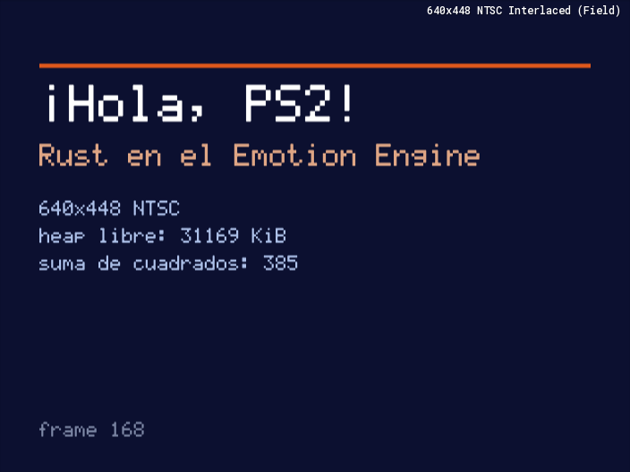
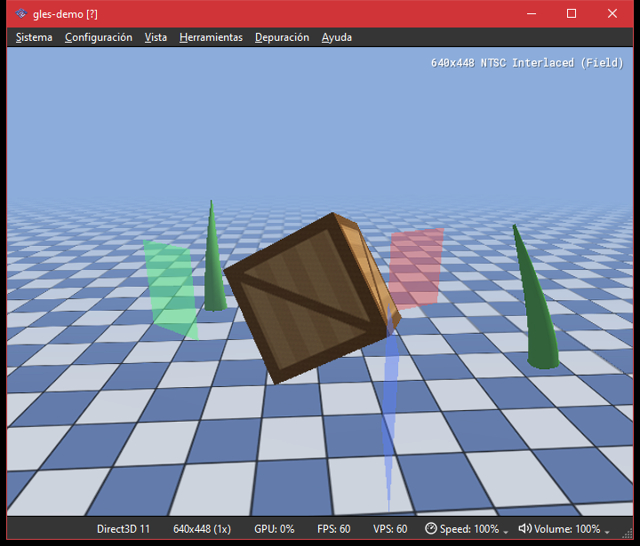
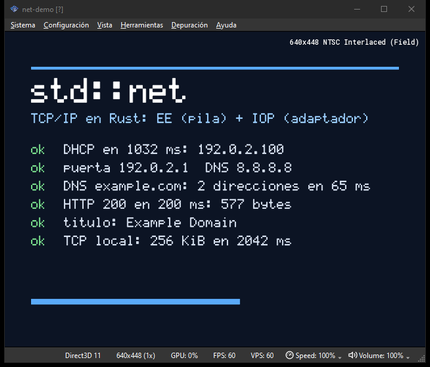
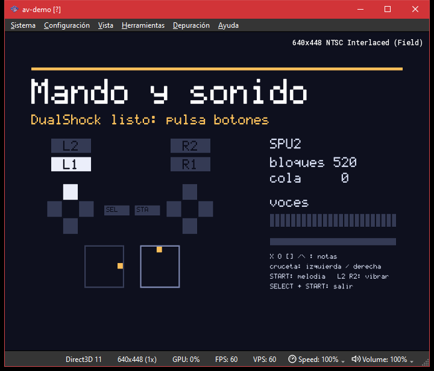
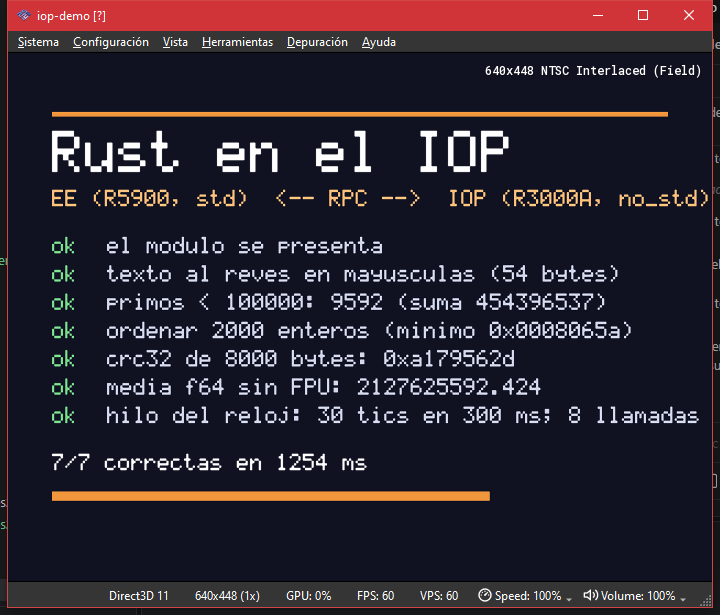

# PS2Rust — Rust para PlayStation 2

Compila programas en Rust, **con la biblioteca estándar**, a ejecutables ELF
para el Emotion Engine (MIPS R5900) de la PlayStation 2. No usa C ni PS2SDK:
el arranque, el kernel, la comunicación con el procesador de E/S, los hilos,
los archivos y los gráficos están escritos en Rust.

También compila **módulos IRX para el IOP** (el procesador de E/S, un MIPS
R3000A con 2 MiB de RAM), sin std: ver [Rust en el IOP](#rust-en-el-iop). Y
trae **OpenGL ES 1.0** sobre el Graphics Synthesizer, con la geometría en la
unidad vectorial VU1, mallas estáticas retenidas y mallas animadas con paleta
de matrices ([OpenGL ES 1.0](#opengl-es-10)),
**red** (`std::net` con una pila TCP/IP propia, más HTTP y WebSocket: [Red](#red))
y **mando y sonido** (DualShock 2 con presión y vibración, flujo PCM y voces
ADPCM: [Mando y sonido](#mando-y-sonido)).

| [`std-hello`](examples/std-hello/src/main.rs) | [`cube`](examples/cube/src/main.rs) | [`hello`](examples/hello/src/main.rs) |
|---|---|---|
|  |  |  |

```rust
use std::{fs, thread, collections::HashMap, time::Duration};

fn main() {
    let worker = thread::spawn(|| (1..=10u32).map(|n| n * n).sum::<u32>());
    let mut save = HashMap::new();
    save.insert("nivel", worker.join().unwrap());
    fs::write("partida.txt", format!("{save:?}")).unwrap();
    thread::sleep(Duration::from_millis(100));
    println!("{}", fs::read_to_string("partida.txt").unwrap());
}
```

```
cargo ps2 run -p std-hello
```

## La biblioteca estándar en la PS2

| Módulo | En la PS2 |
|---|---|
| `std::thread` | Hilos del kernel del EE: `spawn`, `join`, `scope`, `Builder`, `park`/`unpark`, `sleep`, `yield_now`, `thread_local!` (con destructores) |
| `std::sync` | `Mutex`, `Condvar`, `RwLock`, `Once`, `OnceLock`, `LazyLock`, `Barrier`, `mpsc`, atómicos; todo sobre un futex propio |
| `std::time` | `Instant` con el contador de ciclos (resolución de 3,4 ns); `SystemTime` con el reloj de tiempo real de la consola |
| `std::fs` | `host:` (el PC, con PCSX2 o ps2link), `mc0:`/`mc1:` (tarjetas de memoria; los módulos se cargan solos), `cdrom0:` (el disco). Leer, escribir, `seek`, `append`, `metadata`, `read_dir`, `create_dir_all`, `remove_*`, `copy`, `rename` |
| `std::io` | `stdout`/`stderr` a la consola del EE; `stdin` siempre vacío |
| `std::env` | `args` (el kernel los pasa), variables en memoria, `current_dir`/`set_current_dir` (al empezar, el directorio del ELF) |
| `std::collections` | Todo, incluidos `HashMap`/`HashSet` con semillas aleatorias |
| `std::process` | `exit` y `abort`; no hay `Command` |
| `std::net` | `TcpStream`, `TcpListener`, `UdpSocket` y resolución de nombres, con plazos y modo sin bloqueo; DHCP y DNS automáticos. IPv4. Ver [Red](#red) |
| `std::os::ps2` | `load_iop_module`, `SifRpcClient` (llamadas RPC a módulos del IOP: mandos, sonido…), `reset_iop` (reinicia el IOP con los módulos de la BIOS), `network_info` y `set_network_config` (dirección de red), `exe_dir`, `flush_data_cache`, `cpu_cycles`, `heap_free_bytes` |

Un pánico (en cualquier hilo) imprime el mensaje y termina con código 101: se
compila con `panic = "abort"`, no hay desenrollado.

Los hilos son **cooperativos**: todos tienen la misma prioridad en el kernel,
así que un hilo corre hasta que se bloquea (E/S, `Mutex`, canal, `join`),
duerme o llama a `thread::yield_now`. Es el modelo habitual de los juegos de
PS2, y además hace correctos los atómicos del R5900 (ver más abajo).

## Cómo funciona

No es un fork de `rustc`. Es el `rustc` que ya tienes instalado, dirigido a un
target nuevo, más pasos propios antes y después de compilar:

1. **Target `mipsel-sony-ps2`** ([spec](toolchain/cargo-ps2/assets/mipsel-sony-ps2.json)),
   con `target_os = "ps2"`: MIPS II little-endian, ABI o32, FPU de precisión
   simple (`f64` por software), sin PIC, y con el relleno de delay slots de
   LLVM desactivado para esquivar la errata de bucles cortos del R5900.
2. **La std con una plataforma nueva.** `cargo ps2` copia el código de la std
   de tu toolchain (`rust-src`) a `target/ps2-toolchain/`, añade la rama
   `target_os = "ps2"` en cada selector de plataforma (24 inserciones,
   [stdsrc.rs](toolchain/cargo-ps2/src/stdsrc.rs), cada una comprobada contra
   el original) y le suma la implementación de
   [toolchain/std-ps2](toolchain/std-ps2). Luego compila `std`, `core`,
   `alloc` y `panic_abort` con `-Zbuild-std`.
3. **El sistema operativo, en Rust** ([std-ps2/os](toolchain/std-ps2/os)):
   syscalls del kernel del EE; el protocolo SIF (comandos y RPC por DMA)
   para hablar con el IOP; los servidores de la BIOS FILEIO (archivos),
   LOADFILE (módulos) y CDVD (reloj); un temporizador de 1 kHz sobre el
   Timer 1 que extiende el contador de ciclos a 64 bits y despierta a los
   hilos dormidos; un futex; y el heap.
4. **Enlazado** con `rust-lld` y un [linker script](toolchain/cargo-ps2/assets/ps2.ld)
   que carga el programa en `0x00100000`.
5. **Legalización para el R5900** ([r5900.rs](toolchain/cargo-ps2/src/r5900.rs)).
   LLVM no conoce el R5900, así que el ELF enlazado se parchea in situ:

   | LLVM emite | El R5900 | Se reescribe como |
   |---|---|---|
   | `ll` / `sc` + `beqz` (atómicos) | no los tiene | `lw` / `sw` + `li 1` |
   | `c.ult.s`, `c.ule.s`, `c.un.s`… | sólo C.F, C.EQ, C.LT, C.LE | la variante ordenada (su FPU no tiene NaN) |
   | `trunc.w.s` | no existe | `cvt.w.s` (en el R5900 siempre trunca) |
   | `sqrt.s fd, fs` | el operando va en `ft` | mismo opcode, campo movido |
   | `lwl` + `lwr` cuyo valor se usa en cálculos | ver abajo | desvío a un trampolín que añade `sll rt, rt, 0` |

6. **Verificación**: se decodifica cada instrucción del ELF final. Lo que el
   R5900 no implementa (`dmult`, `ddiv`, `movf`, dobles en FPU, `ldc1`…), un
   bucle corto con el delay slot ocupado o una carga no alineada sin corregir
   hacen fallar la compilación.

Todo eso lo orquesta `cargo ps2`, un binario sin dependencias en
[toolchain/cargo-ps2](toolchain/cargo-ps2).

### Las cargas no alineadas y el recompilador de PCSX2

El R5900 tiene registros de 64 bits: el código de 32 bits funciona porque cada
instrucción deja el resultado con el signo extendido a los 64 bits. Con la std
apareció un cuelgue intermitente dentro de `HashMap`: el recompilador del EE de
PCSX2 no extiende el signo en las cargas no alineadas `lwl` + `lwr` (deja ceros
arriba), y las comparaciones de 64 bits del bucle de búsqueda nunca terminaban.
El intérprete de PCSX2 sí lo hace bien.

La corrección está en [unaligned.rs](toolchain/cargo-ps2/src/unaligned.rs):
un análisis de flujo comprueba, por todos los caminos, si el valor cargado sólo
se escribe a memoria (las copias, que son la mayoría); si no, la pareja se
desvía a un trampolín que la ejecuta en su orden y añade `sll rt, rt, 0`. Si
entre las dos mitades hay otras instrucciones, se reagrupan cuando se puede
demostrar que es seguro (no tocan el registro ni la base, y ninguna es destino
de un salto, contando las tablas de saltos de los datos).

## OpenGL ES 1.0

El crate [`ps2-gles`](crates/ps2-gles/src/lib.rs) implementa OpenGL ES 1.0
(perfil Common) y un EGL 1.0 mínimo, con los nombres y las firmas de la
especificación de Khronos: 117 funciones `gl*` (incluidas las variantes de coma
fija) y 20 `egl*`. El código de GLES 1.0 se traduce casi línea a línea:

```rust
use ps2_gles::*;

unsafe {
    let display = eglGetDisplay(EGL_DEFAULT_DISPLAY);
    eglInitialize(display, null_mut(), null_mut());
    let (mut config, mut count) = (0, 0);
    eglChooseConfig(display, [EGL_DEPTH_SIZE, 16, EGL_NONE].as_ptr(), &mut config, 1, &mut count);
    let surface = eglCreateWindowSurface(display, config, PS2_WINDOW_NTSC, null());
    let context = eglCreateContext(display, config, EGL_NO_CONTEXT, null());
    eglMakeCurrent(display, surface, surface, context);

    glEnable(GL_DEPTH_TEST);
    glEnable(GL_LIGHTING);
    glEnable(GL_LIGHT0);
    glVertexPointer(3, GL_FLOAT, 0, vertices.as_ptr().cast());
    glEnableClientState(GL_VERTEX_ARRAY);
    glDrawArrays(GL_TRIANGLES, 0, 36);
    eglSwapBuffers(display, surface);
}
```



La captura es [`gles-demo`](examples/gles-demo/src/main.rs): texturas con
mipmaps, iluminación con brillo especular, niebla, mezcla alfa y búfer de
profundidad, todo con llamadas estándar. Los tallos verdes son una sola malla
animada con paleta de matrices; el suelo, los cristales y los tallos están en
objetos de búfer.

Está todo lo de la especificación 1.0: los siete tipos de primitiva, arrays de
vértices en todos sus formatos, las tres pilas de matrices, ocho luces
(direccionales, puntuales y focos) con materiales, niebla lineal y exponencial,
texturas en todos los formatos de 1.0 más las de paleta
(`OES_compressed_paletted_texture`), filtros y mipmaps, pruebas de alfa,
profundidad y recorte, mezcla, máscaras, `glReadPixels`, `glCopyTexImage2D` y
los errores de GL. Y dos cosas de fuera de 1.0 que en esta consola hacen
falta: los **objetos de búfer** de 1.1 (`glBufferData` y compañía) y la
extensión **`GL_OES_matrix_palette`** (ver más abajo).

### La geometría, en la VU1

`glDrawArrays` y `glDrawElements` no transforman nada en la CPU: mandan los
vértices tal cual a la **unidad vectorial VU1**, por VIF y DMA, y un
microprograma hace ahí la transformación, la iluminación, la niebla, el
descarte de caras y el recorte, y envía los triángulos al GS. El programa no
cambia nada: son las mismas llamadas de GL, más rápidas.

| | Triángulos iluminados por segundo (malla indexada de 2048, en PCSX2) |
|---|---|
| Todo en la FPU del Emotion Engine (antes) | unos 53 000 |
| Geometría en la VU1, vértices en memoria del programa | unos 350 000 |
| Geometría en la VU1, vértices en un objeto de búfer estático | el EE deja de ser el límite (ver [geometría retenida](#geometría-retenida-objetos-de-búfer)) |

- **El microprograma** ([vu1prog.rs](crates/ps2-gles/src/vu1prog.rs)) se
  genera a medida del estado de GL: sin luces no lleva código de luces, cada
  luz lleva el de su tipo, etc., así que dentro no hay comprobaciones de modo.
  Cuesta entre 180 y 470 instrucciones por triángulo (de sin luces a ocho);
  con paleta de matrices, entre 220 y 420 (de una matriz por vértice sin
  luces a cuatro con una luz).
- **Recorte de verdad**: un triángulo que cruza el plano cercano o el lejano,
  o se sale de la banda de guarda del GS, se recorta en la VU1 contra los seis
  planos (un suelo que pasa bajo la cámara no se pierde ni vuelve a la CPU).
- **Nivel de detalle de las texturas** por triángulo, también en la VU1.
- **LLVM no sabe generar código para las VU**, así que el microprograma está
  escrito con un ensamblador mínimo hecho en Rust
  ([vu.rs](crates/ps2-gles/src/vu.rs)), y hay un intérprete de la VU1 para el
  PC ([vuinterp.rs](crates/ps2-gles/src/vuinterp.rs)) que lo ejecuta en las
  pruebas y vigila las trampas del hardware (esperas de la división y del
  registro de recorte, retraso de los saltos).

Va por la VU1 todo triángulo (sueltos, tiras, abanicos, con o sin índices) con
luces direccionales y puntuales (ambiente, difusa, emisión, atenuación, color
como material), niebla lineal, texturas y sombreado suave o plano. **Vuelve a
la CPU**, llamada a llamada y con el mismo resultado, lo que la VU1 no sabe
calcular o no merece la pena: brillo especular, focos, niebla exponencial,
iluminación a dos caras, `glPolygonOffset`, vértices con `w`, y los puntos y
las líneas. `ps2_gles::fast_triangles()` dice cuántos triángulos han ido por
la VU1.

### Geometría retenida: objetos de búfer

Con los vértices en memoria del programa (`glVertexPointer` con un puntero),
GL tiene que leerlos y copiarlos en cada dibujo, porque pueden haber
cambiado: ése era el techo de los 350 000 triángulos por segundo. Con los
**objetos de búfer** de OpenGL ES 1.1 el contenido es de GL, y aquí eso se
aprovecha del todo:

```rust
glGenBuffers(1, &mut buffer);
glBindBuffer(GL_ARRAY_BUFFER, buffer);
glBufferData(GL_ARRAY_BUFFER, bytes, vertices.as_ptr().cast(), GL_STATIC_DRAW);
glVertexPointer(3, GL_FLOAT, stride, 0 as *const GLvoid);   // desplazamiento en el búfer
// …lo mismo con normales, colores, coordenadas de textura e índices
// (GL_ELEMENT_ARRAY_BUFFER)…
glDrawElements(GL_TRIANGLES, count, GL_UNSIGNED_SHORT, 0 as *const GLvoid);
```

La primera vez que se dibuja desde búferes `GL_STATIC_DRAW`, `ps2-gles` arma
el paquete de DMA con los vértices ya en el formato de la VU1 y **lo guarda**.
En los dibujos siguientes el Emotion Engine sólo envía las matrices, las
luces y el resto de constantes (un kilobyte), y el DMA manda los vértices a la
VU1 directamente desde donde quedaron: un nivel entero se redibuja cada frame
sin que la CPU toque un vértice. Cambiar la matriz, las luces, la niebla, la
textura, la mezcla o el color actual no obliga a rehacer nada.

- En PCSX2 la malla de la tabla pasa a "11 millones de triángulos por
  segundo", pero ese número sólo dice que el EE ya casi no trabaja (0,09 µs
  por triángulo): el emulador no cuenta el tiempo de la VU1. En una consola
  el límite pasa a ser la propia VU1; por su número de instrucciones (256 por
  triángulo con una luz), algo más de un millón por segundo.
- Están `glGenBuffers`, `glBindBuffer`, `glBufferData`, `glBufferSubData`,
  `glDeleteBuffers`, `glIsBuffer` y `glGetBufferParameteriv`, con
  `GL_ARRAY_BUFFER` y `GL_ELEMENT_ARRAY_BUFFER`. Se pueden mezclar arrays en
  búferes y en memoria del programa; se retiene sólo cuando todo lo que se
  dibuja sale de búferes estáticos. Los `GL_DYNAMIC_DRAW` funcionan igual
  pero se leen en cada dibujo.
- `glBufferData` y `glBufferSubData` descartan lo retenido de ese búfer, que
  se rehace en el dibujo siguiente. Cada tramo distinto de un búfer (otro
  `first`/`count`, otros índices) es una geometría retenida aparte.
- **Memoria**: la VU1 recibe triángulos sueltos, así que lo retenido ocupa
  144 bytes por triángulo (240 con paleta de matrices), además del búfer
  original. Hay un límite de 8 MiB (unos 58 000 triángulos) que se cambia con
  `ps2_gles::set_retained_budget(bytes)`; al llenarse se suelta lo que lleva
  más tiempo sin dibujarse. `ps2_gles::retained_triangles()` y
  `retained_bytes()` dicen cuánto se está aprovechando.
- Sólo se retiene lo que va por la VU1 (lo de la lista de arriba).

### Mallas animadas: paleta de matrices

Con [`GL_OES_matrix_palette`](https://registry.khronos.org/OpenGL/extensions/OES/OES_matrix_palette.txt)
cada vértice lleva los índices de hasta cuatro matrices de una paleta de 32 y
un peso para cada una, y su modelview es la mezcla. Es el *skinning* de un
personaje con huesos, y aquí **lo hace la VU1**: mezcla las matrices,
transforma la posición y lleva la normal con la traspuesta de la inversa de
la matriz mezclada, como pide la extensión.

```rust
// La pose: una matriz por hueso.
glMatrixMode(GL_MATRIX_PALETTE_OES);
for (i, bone) in bones.iter().enumerate() {
    glCurrentPaletteMatrixOES(i as GLuint);
    glLoadMatrixf(bone.as_ptr());              // o glLoadPaletteFromModelViewMatrixOES()
}
// La malla: además de posiciones y normales, índices y pesos.
glEnable(GL_MATRIX_PALETTE_OES);
glEnableClientState(GL_MATRIX_INDEX_ARRAY_OES);
glEnableClientState(GL_WEIGHT_ARRAY_OES);
glMatrixIndexPointerOES(4, GL_UNSIGNED_BYTE, stride, indices);
glWeightPointerOES(4, GL_FLOAT, stride, weights);
glDrawElements(GL_TRIANGLES, count, GL_UNSIGNED_SHORT, triangles);
```

Si la malla está en objetos de búfer estáticos, también queda retenida: en
cada frame el Emotion Engine sólo calcula las matrices de los huesos y las
envía (2 KiB); ningún vértice pasa por la CPU, por muchos que tenga el
personaje.

- `GL_MAX_PALETTE_MATRICES_OES` = 32 y `GL_MAX_VERTEX_UNITS_OES` = 4. Un
  modelo con más huesos se dibuja por partes, cada una con su paleta.
- Los pesos se usan tal cual (no se normalizan ni se calcula el último); lo
  normal es que sumen 1.
- Con la paleta activa `GL_RESCALE_NORMAL` equivale a `GL_NORMALIZE` (no hay
  un único factor de escala). Con luces puntuales, la VU1 supone que los
  pesos suman 1.
- Con lo que no va por la VU1 (brillo especular, focos…) el *skinning* lo
  hace el Emotion Engine, con el mismo resultado.

Lo que el GS no puede hacer, y cómo se comporta aquí:

| De GLES 1.0 | En la PS2 |
|---|---|
| `glBlendFunc` | Exactas las 20 parejas formadas con `GL_ZERO`, `GL_ONE` y los alfas de origen y destino que caben en la fórmula del GS (entre ellas la transparencia normal y la aditiva). Las que usan un color como factor (`GL_DST_COLOR`…), `GL_SRC_ALPHA_SATURATE` y unas pocas como `GL_ONE, GL_ONE_MINUS_SRC_ALPHA` no existen: se dibuja sin mezcla. El alfa que queda en el framebuffer es el del fragmento, sin mezclar. |
| `glDepthFunc` | `GL_LESS`, `GL_LEQUAL`, `GL_ALWAYS` y `GL_NEVER` exactas. `GL_GREATER`/`GL_GEQUAL` funcionan si no se mezclan con las anteriores en el mismo frame. `GL_EQUAL` se trata como `GL_LEQUAL` y `GL_NOTEQUAL` como `GL_ALWAYS`. |
| `glTexEnv` | `GL_MODULATE` y `GL_REPLACE` exactos; `GL_DECAL` exacto con texturas RGB (con RGBA ignora el alfa de la textura). `GL_BLEND` y `GL_ADD` se dibujan como `GL_MODULATE`. |
| Stencil | Configuraciones sin stencil (0 bits), como permite la especificación: su prueba siempre pasa. |
| `glLogicOp`, tramado, suavizado de puntos y líneas, multimuestreo | Se aceptan y no tienen efecto. |
| Texturas | Potencias de dos hasta 512×512, una unidad de textura, hasta 7 niveles de mipmap con el nivel de detalle calculado por triángulo (las superficies grandes en perspectiva, como un suelo, conviene dividirlas en una rejilla). Se guardan en 32 bits: con 16 bits de profundidad quedan 1,27 MiB de memoria de vídeo para texturas (0,72 MiB con 24). |

El crate también compila en el PC, donde rasteriza una referencia por software
que sigue la especificación al pie de la letra. La batería
[`gles-selftest`](examples/gles-selftest/src/gl_suite.rs) dibuja, lee los
píxeles con `glReadPixels` y los compara con lo que manda la especificación:
315 comprobaciones que pasan igual en el PC y en la PS2 (donde los triángulos
van por la VU1), y también en el PC con el microprograma interpretado.

## Red

`std::net` funciona: la PS2 pide dirección por DHCP, resuelve nombres por DNS
y abre conexiones TCP y UDP con el adaptador de red (en PCSX2, el Ethernet
emulado).

```rust
use std::io::{Read, Write};
use std::net::{TcpStream, UdpSocket};
use std::time::Duration;

let mut stream = TcpStream::connect("example.com:80")?;        // DHCP y DNS, solos
stream.set_read_timeout(Some(Duration::from_secs(5)))?;         // o set_nonblocking(true)
stream.write_all(b"GET / HTTP/1.1\r\nHost: example.com\r\nConnection: close\r\n\r\n")?;
let mut page = String::new();
stream.read_to_string(&mut page)?;

let socket = UdpSocket::bind("0.0.0.0:0")?;
socket.send_to(b"hola", "192.168.1.20:9000")?;
let (n, from) = socket.recv_from(&mut [0u8; 1500])?;
```



Está hecho en dos mitades, las dos en Rust y sin código ajeno:

- **`ps2net.irx`** ([crates/ps2net](crates/ps2net/src/main.rs)), un módulo del
  IOP con el driver del adaptador: enciende la interfaz de expansión (DEV9),
  lee la dirección MAC de la EEPROM, arranca el controlador Ethernet (SMAP) y
  negocia el enlace. Sólo mueve tramas Ethernet. `cargo ps2` lo compila y lo
  deja junto al ELF, y la std lo carga de la carpeta del ejecutable la primera
  vez que se usa la red (en un disco o una tarjeta de memoria debe ir al lado
  del programa).
- **La pila TCP/IP** ([stack.rs](toolchain/std-ps2/net/stack.rs)) dentro de la
  std, en el EE: ARP, IPv4, ICMP (responde a ping), UDP, TCP y los clientes de
  DHCP y DNS. Encima va `std::net` completo para IPv4: `TcpStream` (con
  `set_read_timeout`, `set_nonblocking`, `peek`, `shutdown`, `try_clone`…),
  `TcpListener`, `UdpSocket` y `ToSocketAddrs` con nombres de host.

`std::os::ps2::network_info()` devuelve la dirección obtenida y
`set_network_config` la fija a mano si no hay DHCP. Sólo 127.0.0.1 es bucle
local: el resto de 127.0.0.0/8 sale por el adaptador, lo que con PCSX2 permite
hablar con servicios del propio PC (por ejemplo uno que escuche en 127.0.0.2).

### HTTP y WebSocket

El crate [`ps2-web`](crates/ps2-web/src/lib.rs) pone encima un cliente
HTTP/1.1 y WebSocket, sólo con la biblioteca estándar (funciona igual en el
PC):

```rust
use ps2_web::{http, ws::{Message, WebSocket}};

let page = http::get("http://example.com/")?;                  // sigue redirecciones
let reply = http::post("http://192.168.1.20:8080/api", "application/json", "{\"hola\":1}")?;

let mut socket = WebSocket::connect("ws://192.168.1.20:9000/chat")?;
socket.set_read_timeout(Some(Duration::from_secs(10)))?;
loop {
    match socket.read() {
        Ok(Message::Text(text)) => println!("{text}"),
        Err(ps2_web::Error::Timeout) => socket.ping(b"latido")?,  // conexión larga con latidos
        Ok(Message::Close(_)) | Err(_) => break,
        Ok(_) => {}
    }
}
```

HTTP: `GET`/`POST` y cualquier otro método con `Request`, cabeceras, cuerpos
con `Content-Length`, troceados o hasta el cierre, y redirecciones. WebSocket:
texto, binario, ping/pong, mensajes fragmentados, cierre, y también el lado
servidor (`WebSocket::accept`). **Sin TLS**: `https://` y `wss://` devuelven
`Error::Tls`.

## Mando y sonido

Lo que le falta a un motor para ser un juego. Los dos viven en el IOP y los
dos crates hablan con él por RPC desde un programa con std.



### Mando: `ps2-pad`

```rust
use ps2_pad::{Button, Pads};

let mut pads = Pads::init()?;
let mut pad = pads.open(0)?;                 // puerto 1 de la consola
loop {
    if let Some(input) = pad.poll() {        // una vez por frame
        if input.pressed(Button::Cross) { /* saltar */ }
        let fuerza = input.pressure(Button::R2);       // 0..=255
        let (x, y) = input.left_stick();               // -1.0..=1.0
        pad.rumble(false, fuerza);                     // motor grande
    }
}
```

[`ps2-pad`](crates/ps2-pad/src/lib.rs) carga los módulos de mandos de la BIOS
(`rom0:XSIO2MAN` y `rom0:XPADMAN`, o los `SIO2MAN`/`PADMAN` originales en las
primeras consolas: los dos protocolos están implementados y probados) y lee el
estado que el IOP deja una vez por frame en la memoria del EE. `poll` también
configura el mando cuando se conecta, sin bloquear: modo analógico fijado,
motores de vibración y botones sensibles a la presión. Da los 16 botones, los
dos sticks, la presión de 12 botones y la vibración de los dos motores, en los
dos puertos, y detecta cuándo se enchufa y se desenchufa.

### Sonido: `ps2-audio`

```rust
use ps2_audio::{to_stream, Audio};

let mut audio = Audio::init()?;

// Flujo PCM: música, o la mezcla de tu motor. Estéreo, 16 bits, 48 kHz.
audio.write_all(&to_stream(&pcm_44100_mono, 1, 44100));

// Efectos: muestras en las 24 voces del chip, con volumen por canal y tono.
let disparo = audio.load_sample(&pcm_mono, 22050, false)?;
audio.play(0, &disparo, 1.0, 0.4);
audio.play_at(1, &disparo, 0.5, 0.5, 1.5);   // más agudo
```

[`ps2-audio`](crates/ps2-audio/src/lib.rs) tiene dos mitades. En el IOP,
[`ps2snd.irx`](crates/ps2snd/src/main.rs): un módulo en Rust que usa la
biblioteca de sonido de la BIOS (`rom0:LIBSD`) para manejar el chip (SPU2);
`cargo ps2` lo compila y lo deja junto al ELF, como el de red. En el EE, la
API:

- **Flujo PCM**: una cola de 16 384 muestras estéreo (unos 340 ms) que el
  módulo va entregando al chip en bloques de 512, 93,75 veces por segundo.
  `write` no bloquea y dice cuántas cupieron; `write_all` espera; `status`
  dice cuánto queda en cola. `to_stream` convierte mono o estéreo de cualquier
  frecuencia a 48 kHz.
- **Voces**: `load_sample` codifica PCM al ADPCM del chip
  ([adpcm.rs](crates/ps2-audio/src/adpcm.rs), también usable en el PC para
  preparar los datos de antemano) y lo sube a la memoria de sonido; `play` lo
  toca en una de las 24 voces, una vez o en bucle, con volumen por canal y
  velocidad; `is_playing`, `free_voice`, `stop`.

[`av-demo`](examples/av-demo/src/main.rs) junta las dos cosas: dibuja el mando
en vivo y toca notas con los botones (más fuerte cuanto más se aprieta), una
melodía por el flujo con Start y vibra con L2/R2.

## Rust en el IOP

La PS2 tiene un segundo procesador, el IOP: un R3000A (MIPS I, el de la
PlayStation original) con 2 MiB de RAM que se ocupa de los mandos, el sonido,
el disco y la red. Sus programas son módulos `.irx` que la BIOS carga y enlaza
con el kernel. `cargo ps2 build --iop` los compila desde Rust (`no_std` +
`alloc`), con el crate [`ps2-iop`](crates/ps2-iop/src/lib.rs) como runtime:

```rust
#![no_std]
#![no_main]
use ps2_iop::{println, rpc};

ps2_iop::module!(name: "doble", version: (1, 0), main: main);

fn main() {
    println!("hola desde Rust en el IOP");
    // Servidor RPC: un programa del EE lo llama con SifRpcClient.
    rpc::serve(0x1234_5678, 64, |_function, data, _received| {
        let n = u32::from_le_bytes(data[..4].try_into().unwrap());
        data[..4].copy_from_slice(&(n * 2).to_le_bytes());
    });
}
```



En la captura, [`iop-demo`](examples/iop-demo/src/main.rs) (EE, con std) carga
[`rustiop.irx`](examples/iop-module/src/main.rs) en el IOP y le pide por RPC
dar la vuelta a un texto UTF-8, cribar primos, ordenar, un CRC-32 y una media
en `f64`; cada respuesta se compara con el mismo cálculo hecho en el EE.
Mientras, un segundo hilo del módulo cuenta tics.

| Módulo de `ps2-iop` | Qué ofrece |
|---|---|
| `module!` | Identidad del módulo, punto de entrada y `main` en su propio hilo |
| `print!` / `println!` | Consola del IOP |
| `heap` | Asignador global (`Box`, `Vec`, `String`, `BTreeMap`…) sobre un bloque pedido al kernel |
| `thread` | Hilos del kernel, expulsivos y con prioridades: `spawn`, `Builder`, `sleep_ms` |
| `sync` | `Mutex` y `Semaphore` (semáforos del kernel) |
| `rpc` | `serve`: servidor RPC para los programas del EE |
| `time`, `math` | Reloj del sistema; `sqrt` en `f32` sin FPU |
| `kernel` | Las funciones importadas de la BIOS (`thbase`, `thsemap`, `sysmem`, `intrman`, `sifcmd`, `stdio`) y `critical` |

Cómo se llega del código de Rust a un `.irx`:

1. **Target `mipsel-sony-ps2iop`**: MIPS I, coma flotante por software, sin
   atómicos (el R3000A no tiene `ll`/`sc`), sólo `core` y `alloc`.
2. **Importaciones.** En el IOP no hay syscalls: cada función del kernel se
   declara en una tabla dentro del código, con un hueco de dos instrucciones
   que el cargador sustituye por un salto. Las genera una macro de `ps2-iop`.
3. **Conversión a IRX.** El módulo se enlaza en la dirección 0 conservando las
   relocaciones y `cargo-ps2` lo convierte al formato de Sony (ELF de tipo
   `0xFF80`, sección `.iopmod`, relocaciones relativas a la base de carga).
4. **El cargador de la BIOS ignora un `R_MIPS_LO16` que no vaya justo detrás
   de un `R_MIPS_HI16`.** Los compiladores de C emiten siempre la pareja, pero
   LLVM reutiliza un `lui` para varios accesos; sin corregirlo, el módulo carga
   y luego lee y escribe en direcciones equivocadas. El conversor empareja cada
   entrada con palabras auxiliares (detalles en
   [irx.rs](toolchain/cargo-ps2/src/irx.rs)).
5. **HI/LO.** MIPS I pide dos instrucciones entre `mfhi`/`mflo` y el siguiente
   `mult`/`div`; LLVM no las pone. `cargo-ps2` desvía esas secuencias a
   trampolines que guardan la distancia.
6. **Verificación.** Todo IRX se revisa instrucción a instrucción: sólo MIPS I,
   sin FPU, respetando el retardo de carga y la regla de HI/LO. Con
   `--verify-relocs` además se enlaza el módulo en otra dirección y se comprueba
   que el IRX, reubicado ahí con las reglas del cargador, queda idéntico
   palabra por palabra.

## Requisitos

- Rust estable con el componente `rust-src` (`rustup component add rust-src`).
  Probado con rustc 1.97.1. `cargo ps2` activa `RUSTC_BOOTSTRAP=1` porque el
  target JSON, `build-std` y el ensamblador en línea para MIPS son inestables.
  Si una versión futura de Rust cambia los archivos de la std que se parchean,
  `cargo ps2` lo detecta y lo dice en vez de compilar algo roto.
- Para `cargo ps2 run`: PCSX2 con una BIOS (la BIOS no se incluye: vuélcala de
  tu consola). La ruta del emulador se toma de `--emulator` o de la variable de
  entorno `PCSX2_EXE`; también se puede fijar en [.cargo/config.toml](.cargo/config.toml).
  Para que `host:` funcione, PCSX2 necesita la opción *Host Filesystem*
  activada.

## Uso

Desde la raíz de este repositorio no hay que instalar nada (hay un alias en
`.cargo/config.toml`):

```
cargo ps2 run -p std-hello         # compila y ejecuta en PCSX2, mostrando la consola
cargo ps2 build -p cube            # compila -> target/ps2/cube.elf
cargo ps2 run -p cube --until "240 frames" --screenshot cube.png
cargo ps2 check juego.elf          # ¿este ELF sólo usa instrucciones del R5900?
cargo ps2 build --iop -p rustiop   # módulo del IOP -> target/ps2/rustiop.irx
cargo ps2 run -p iop-demo          # el programa del EE que lo carga y lo llama
cargo ps2 check modulo.irx         # ¿este IRX sólo usa instrucciones del R3000A?
cargo ps2 run -p gles-demo         # OpenGL ES 1.0 sobre el Graphics Synthesizer
cargo ps2 run -p net-demo          # DHCP, DNS y una página de Internet por HTTP
cargo ps2 run -p av-demo --keep-open   # mando y sonido: pruébalo con tu mando
cargo ps2 help
```

Compila los paquetes de uno en uno (`-p`): los ejemplos sin std y con std usan
el crate `ps2` con features distintas, y los módulos del IOP son otro target.
Un programa del EE carga un módulo con `std::os::ps2::load_iop_module`; en
PCSX2, `host:` es el directorio del ELF (`target/ps2`), donde también quedan
los `.irx`.

Para usarlo en un proyecto propio, fuera de este repositorio:

```
cargo install --git https://github.com/mostazaniikkkk/PS2Rust cargo-ps2
```

```toml
# Cargo.toml de tu proyecto
[dependencies]
# Gráficos y hardware; sin el runtime no_std, porque lo pone la std.
ps2 = { git = "https://github.com/mostazaniikkkk/PS2Rust", default-features = false }

[profile.release]
panic = "abort"
```

Para un módulo del IOP, la dependencia es
`ps2-iop = { git = "https://github.com/mostazaniikkkk/PS2Rust" }`; para OpenGL
ES, `ps2-gles = { git = "https://github.com/mostazaniikkkk/PS2Rust" }`, con o
sin std; para HTTP y WebSocket, `ps2-web` igual, y `ps2-pad` y `ps2-audio`
para mando y sonido. `std::net` no necesita nada:
viene con la std.

El `.elf` resultante se puede cargar en PCSX2 (Sistema → Ejecutar ELF) o en una
consola con un lanzador de homebrew.

## El crate `ps2`

El hardware que la std no cubre. Con la std se usa con
`default-features = false`; sin std (`#![no_std]`), la feature `rt` (por
defecto) añade el arranque, el asignador, el manejador de pánicos y
`ps2::entry!`.

| Módulo | Qué ofrece |
|---|---|
| `gs` | Graphics Synthesizer: NTSC/PAL, doble búfer, vsync, rectángulos, líneas, triángulos Gouraud, mezcla alfa, texto. Y el acceso de bajo nivel sobre el que está hecho `ps2-gles`: registros, subida de imágenes y lectura de la memoria de vídeo |
| `math` | `sqrt`, `sin`, `cos`, `floor` en `f32` sobre la FPU |
| `kernel` | Syscalls del kernel del EE y registros de hardware de 32 y 64 bits |
| `print!` / `println!` | Consola del EE, también sin std |
| `entry!`, `heap`, `exit` | Sólo con `rt`: el runtime de los programas `no_std` |

## Ejemplos

- [std-hello](examples/std-hello/src/main.rs): cuatro hilos y un canal, `HashMap`, un archivo, el reloj de la consola y el resultado en pantalla.
- [std-selftest](examples/std-selftest/src/std_suite.rs): batería de la std (25 comprobaciones, más las 33 de `core`/`alloc`).
- [std-panic](examples/std-panic/src/main.rs): pánico en un hilo con nombre.
- [hello](examples/hello/src/main.rs), [cube](examples/cube/src/main.rs), [selftest](examples/selftest/src/suite.rs), [panic](examples/panic/src/main.rs): los mismos temas sin std (`#![no_std]`).
- [av-demo](examples/av-demo/src/main.rs) y [av-selftest](examples/av-selftest/src/main.rs): mando y sonido, y su batería (con [pad-keys](examples/av-selftest/src/bin/pad-keys.rs) para probar cada botón con teclas simuladas).
- [net-demo](examples/net-demo/src/main.rs) y [net-selftest](examples/net-selftest/src/net_suite.rs): la PS2 en Internet, y la batería de `std::net`, HTTP y WebSocket.
- [gles-demo](examples/gles-demo/src/main.rs) y [gles-selftest](examples/gles-selftest/src/gl_suite.rs): una escena con OpenGL ES 1.0 y su batería de pruebas de píxeles.
- [iop-module](examples/iop-module/src/main.rs) (`rustiop.irx`) e [iop-demo](examples/iop-demo/src/main.rs): un módulo del IOP con servidor RPC y dos hilos, y el programa del EE que lo usa.
- [iop-selftest](examples/iop-selftest/src/main.rs) e [iop-selftest-runner](examples/iop-selftest-runner/src/main.rs): la batería de `core`/`alloc` corriendo en el IOP, lanzada desde el EE.

## Verificación

```
powershell -ExecutionPolicy Bypass -File verify.ps1 -Emulator C:\ruta\pcsx2-qt.exe
```

El script compila los quince paquetes del EE y los cuatro módulos del IOP, los
ejecuta en PCSX2 y comprueba los resultados (23 pasos; uno más con
`-PadEmulator`, que prueba cada botón del mando enviando teclas simuladas a un
PCSX2 que tenga el mando 1 en el teclado). La batería de mando y sonido hace
sonar tonos cortos y bajos. Las pruebas principales
son diferenciales: las baterías se compilan tal cual para el PC y para la PS2,
y las dos salidas deben coincidir byte a byte (212 líneas con la std en el EE;
131 en el IOP, donde la misma batería corre sin FPU ni atómicos; 339 la de
OpenGL ES, que compara píxeles leídos del GS con la referencia; 98 la de
red, en la que la PS2 y el PC hablan con el mismo servidor de pruebas, que el
script levanta en 127.0.0.2 y sólo es accesible desde el propio PC). La demo
de red hace además una petición real a `example.com`, así que ese paso
necesita Internet. Cubren enteros de 32/64/128
bits, `f64` por software, `f32` en la FPU, formato, colecciones, `Rc`/`Arc`,
atómicos, el heap, UTF-8, hilos, `Mutex`/`Condvar`/`RwLock`/`Barrier`,
canales, `thread_local!`, `sleep`, `SystemTime`, archivos (incluidos nombres
de 1 a 16 caracteres) y el entorno.

## Límites conocidos

- **Probado sólo en emuladores** (PCSX2 2.7.513 con BIOS real, y Play! 0.47 la
  versión sin std), no en una consola física.
- **Hilos cooperativos.** No hay reparto de tiempo: un hilo que calcula sin
  bloquearse ni ceder no deja correr a los demás. Los atómicos se compilan como
  `lw`/`sw` (el R5900 no tiene `ll`/`sc`); son correctos porque ningún hilo
  pierde la CPU en medio de una operación y los manejadores de interrupción no
  los usan.
- **ABI o32 de 32 bits.** No se puede enlazar con las bibliotecas C de PS2SDK
  (que usan n32). `u64` funciona pero con pares de registros, y el código Rust
  no puede usar los registros de 128 bits (MMI) ni los de la VU0 como
  coprocesador. La VU1 sí se usa: `ps2-gles` le envía un microprograma hecho
  con su propio ensamblador (ver [OpenGL ES 1.0](#opengl-es-10)), pero no hay
  forma de escribir microprogramas en Rust.
- **`f32` sigue la FPU de la PS2**, no IEEE 754: sin NaN, infinitos ni
  denormales, y redondeo hacia cero. `f64` sí es IEEE 754 (por software, lento).
- **Archivos**: el FILEIO de la BIOS no sabe renombrar (`rename` copia y borra,
  no es atómico), ni bloquear, truncar o cambiar fechas y permisos. Un archivo
  abierto no se puede borrar en `host:`. Las fechas de la PS2 están en hora de
  Japón; las de los archivos de `host:` con PCSX2 llegan en la hora local del
  PC, así que `modified()` puede desfasarse unas horas.
- **Sin `std::process::Command` ni `stdin`.**
- **Mando y sonido** necesitan la std (hablan con el IOP por RPC). El mando
  usa los módulos de la BIOS, sin multitap: un mando por puerto. El sonido es
  estéreo a 48 kHz, sin reverberación ni salida digital multicanal; el
  codificador ADPCM es sencillo (unos 25 dB o más de relación señal/ruido en
  las pruebas). Las primeras consolas japonesas no traen `rom0:LIBSD` y ahí
  `Audio::init` falla. En las pruebas se comprueba que las muestras llegan al
  chip y lo que mezclan las voces leyendo su memoria, pero nadie ha escuchado
  la salida desde las pruebas automáticas, y la vibración sólo se sabe que el
  mando emulado la acepta. Probado en PCSX2, no en una consola.
- **Red**: sólo IPv4, sin multidifusión ni fragmentación de IP. No hay TLS:
  `ps2-web` habla `http://` y `ws://`, no `https://` ni `wss://` (la mayoría
  de los servicios de Internet de hoy, Steam incluido, exigen TLS). El TCP es
  sencillo: retransmite por temporizador, no reordena segmentos adelantados ni
  tiene control de congestión, así que rinde bien en una red local y regular
  en enlaces con muchas pérdidas. La pila avanza cuando el programa llama a la
  red; un programa que pasa mucho tiempo sin tocarla no contesta entre tanto
  (ni a pings ni a los datos que le envían). Sólo se ha probado con la red
  emulada de PCSX2, que además no devuelve los rechazos de conexión (un puerto
  cerrado del PC se ve como una conexión que caduca) ni admite conexiones
  entrantes desde fuera; el driver del adaptador sigue el hardware real pero
  no se ha ejecutado en él.
- **OpenGL ES 1.0 no es conforme al 100 %**: la mezcla, la comparación de
  profundidad y el entorno de textura tienen las diferencias de la tabla de
  [OpenGL ES 1.0](#opengl-es-10), que vienen del hardware. La geometría de
  los triángulos va por la VU1 salvo con brillo especular, focos, niebla
  exponencial, dos caras o `glPolygonOffset`, que siguen en la FPU del EE
  (unas siete veces más lento). Con los vértices en memoria del programa el
  límite lo pone el EE, que los lee y copia en cada dibujo (unos 350 000
  triángulos por segundo); desde objetos de búfer estáticos quedan retenidos
  y el límite es la VU1, que no se ha medido en una consola: PCSX2 no cuenta
  su tiempo, y la cifra de "algo más de un millón por segundo" sale de contar
  instrucciones. El microprograma va con una instrucción por posición, sin
  emparejar; hay margen. La geometría retenida ocupa 144 bytes por triángulo.
  De OpenGL ES 1.1 sólo están los objetos de búfer, y de las extensiones de
  *skinning*, `GL_OES_matrix_palette` (no `OES_draw_texture`, planos de
  recorte de usuario, puntos con tamaño por vértice ni el resto de 1.1). No se enlaza con C: es para
  programas en Rust. En PCSX2 con renderizado por hardware, `glReadPixels`
  puede no ver el borde derecho e inferior de puntos y líneas recién dibujados
  (el emulador sólo devuelve la zona que cree dibujada); en pantalla están.
- **IOP: sin std, sin atómicos y sin FPU.** Sólo `core` y `alloc`; no hay
  `Arc` ni `core::sync::atomic` (para compartir datos entre hilos están
  `ps2_iop::sync::Mutex` y `kernel::critical`), y `f32`/`f64` van por software.
  Un pánico imprime el mensaje y deja dormido el hilo: el módulo no se descarga.
  `ps2-iop` cubre hilos, semáforos, memoria, consola y RPC; para otros servicios
  del kernel (interrupciones, DMA, dispositivos) hay que declarar sus tablas de
  importación con la misma macro. El comportamiento del cargador se ha medido
  con la BIOS real dentro de PCSX2, no en una consola.
- PCSX2 decodifica la consola del EE como Shift-JIS: el texto no ASCII, `\` y
  `~` se pierden en su log (no en pantalla; `gs::text` dibuja `ñ`, `¡` y `¿`).

## Licencia

[CC0 1.0](LICENSE): dominio público. Haz lo que quieras con esto, sin pedir
permiso ni dar crédito. La std que `cargo ps2` genera en `target/` es una copia
modificada de la de Rust y conserva su licencia (MIT o Apache 2.0).
